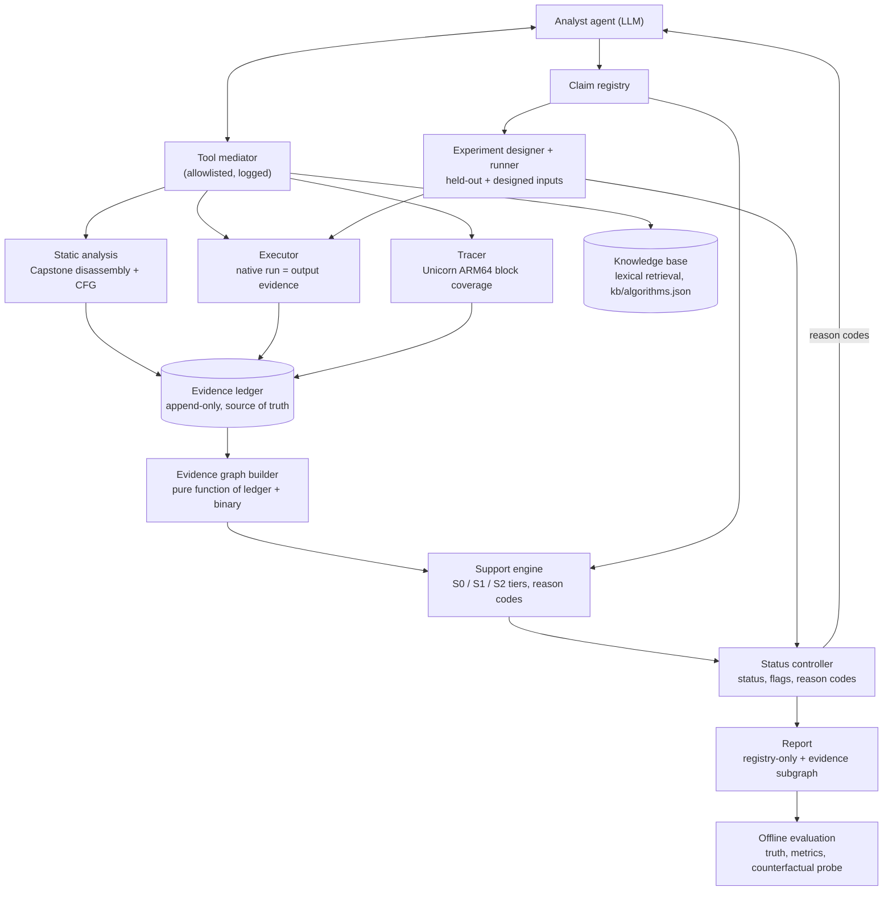
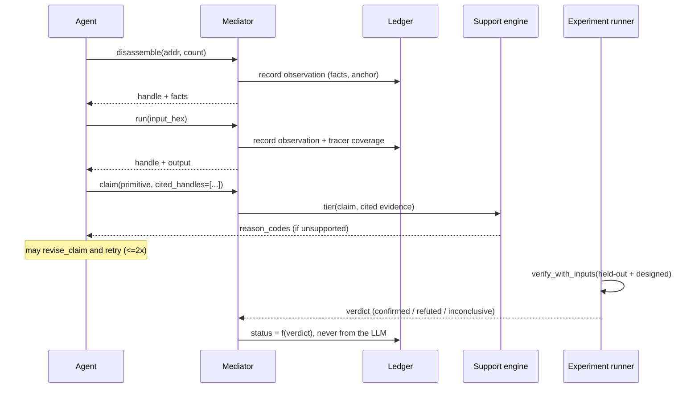

# EGRE — Evidence-Grounded Agentic Reverse Engineering

**Do an LLM reverse-engineering agent's conclusions actually follow from the evidence it
retrieved — and can a deterministic evidence gate catch it when they don't?**

EGRE is a final-year research-engineering project that builds a small, fully native,
offline-auditable harness around an LLM agent doing binary reverse engineering. The agent
investigates a stripped function and submits typed claims ("this function implements
CRC-32"). Every claim is checked, independently and deterministically, against the evidence
the agent actually cited — never against the agent's own stated confidence — and separately
against ground truth and a live experiment. The project measures how often those three things
(cited evidence, agent confidence, truth) agree and disagree, and builds progressively
stronger evidence-quality checks to close the gap.

No paid API key is used anywhere in this repository. All agent runs are either deterministic
scripted policies or a local model served by Ollama.

## Status

| | |
|---|---|
| **v1 prototype** | Complete. 7-program corpus, one claim type, scripted policies + one local-model pilot. See [docs/RESULTS_PROTOTYPE.md](docs/RESULTS_PROTOTYPE.md). |
| **v2** | 19 of 20 tasks complete (engine, agent tools, evaluation — everything is built and tested). One task left: a full model run on real hardware. See [docs/STATUS.md](docs/STATUS.md) and [docs/TASKS.md](docs/TASKS.md). |
| **Tests** | 329 passing (`ruff` + `mypy` + `pytest`, including toolchain-marked tests that build and run real arm64 binaries). |

## Why this exists

Prior work on reverse-engineering agents (and on retrieval-augmented generation generally)
mostly asks "did the agent get the right answer?" or "how far did it get?" EGRE asks a
narrower, more mechanical question instead: *given exactly the evidence handles an agent
cited, does a deterministic checker agree the claim is supported* — independent of whether
the claim happens to be true. The gap between "supported" and "true" is where silent failure
modes live: a model can be right by accident (no real evidence, but correct), or wrong for a
plausible reason (a decoy constant sitting in dead code). See
[docs/OVERVIEW.md](docs/OVERVIEW.md) for the full research framing, related work, and
hypotheses.

## Architecture



The agent is the **only** component that calls an LLM. Every other box is deterministic
Python: the tool mediator logs every call the agent makes to an append-only ledger the agent
cannot write to directly; the evidence graph and support engine turn that ledger into a
verdict on whether a claim's *cited* evidence actually supports it; the experiment runner
settles the question of truth by executing the real binary. No LLM ever decides whether a
claim is correct (see [Invariants](#invariants) below).

### Claim lifecycle



## How a claim gets scored

A claim's cited evidence is scored under three increasingly strict modes, run side by side
so the gap between them is itself the result:

| Mode | What counts as support |
|---|---|
| **S0** (v1) | A signature constant appears *anywhere* in the cited disassembly, or 2+ cited runs match the reference. |
| **S1** | Contrastive: a constant or run only counts if no rival hypothesis is *equally or better* supported by the same evidence. |
| **S2** | S1, plus **execution-qualified**: a disassembly constant only counts if the block holding it was actually entered by a traced run — a constant sitting in dead code no longer counts at all. |

Tiers, worst to best: `contradicted < none < contested < structural < behavioral`. Status
(`refuted` / `verified` / `unverified`) comes **only** from an independent experiment
(`egre.runner.experiment`) that runs the real binary on held-out and specially-designed
inputs — never from the support tier, and never from the LLM.

## Repository layout

```text
src/egre/
  agent/        bounded JSON-action loop, scripted policies (P1-P4), replay
  mediator/     allowlisted tools (disassemble, read_memory, run, query_graph, lookup_knowledge)
  ledger/       append-only observation store, constant extraction
  graph/        CFG builder (Capstone) + evidence graph builder (networkx)
  support/      S1/S2 contrastive tiers, open/closed-world scoring
  tracer/       Unicorn ARM64 emulator -- basic-block execution coverage
  controller/   v1 and v2 status/flags/reason-code derivation
  contracts/    v1's T2 (hash-primitive) claim contract
  claims/       claim schema, registry (add/revise/retract)
  runner/       native executor, verdict runner, experiment designer
  knowledge/    kb/algorithms.json loader + lexical lookup
  llm/          provider-neutral client interface, OpenAI-compatible adapter, fake client
  cli/          `python -m egre.cli.run` -- drives a real/local model end to end
  evaluation/   metrics (v1 and v2), re-scoring, counterfactual probe, offline demo
  report/       registry-only report rendering + per-claim Mermaid subgraphs
corpus/         22 stripped arm64 Mach-O binaries (11 programs x -O0/-O2), truth oracles,
                reference + held-out vectors (human-owned, protected)
kb/             algorithms.json -- 10 validated hash-algorithm entries for open-world mode
tests/          329 tests mirroring the src/ layout; toolchain-marked tests need the
                real toolchain (clang, codesign, Capstone, Unicorn)
docs/           specs, decisions, status, and the project overview (see below)
```

## Quick start (native macOS, Apple Silicon)

```bash
xcode-select --install && brew bundle
python3.11 -m venv .venv && source .venv/bin/activate
pip install -e ".[dev,re]"          # add .[llm] too if you'll run a real model
./scripts/check_env.sh              # verifies clang/strip/codesign/capstone/unicorn etc.
python -m egre.corpus.build         # builds the 22-binary corpus from corpus/catalog.json
./scripts/verify.sh --full          # ruff + mypy + all 329 tests, including toolchain ones
```

No Ghidra, no Docker, no angr are required anywhere in this project (deliberately —
see [docs/DECISIONS.md](docs/DECISIONS.md)).

## Running it

### Scripted, offline, no model needed

```bash
source .venv/bin/activate
python -m egre.demo                 # v1: P1-P3 over the original 7 programs, S0 only
python -c "
from pathlib import Path
from egre.evaluation.demo_v2 import build_demo_v2
from egre.evaluation.metrics_v2 import summarize_v2
runs = build_demo_v2(Path('.'))
summary = summarize_v2(runs)
for view in summary.views: print(view)
"                                    # v2: P1-P4 over all 22 binaries, S0/S1/S2 + verdicts
```

### Against a real local model (Ollama, no API key)

```bash
brew install ollama
ollama serve &
ollama pull qwen3.5:4b              # or any OpenAI-tool-calling-capable local model

source .venv/bin/activate
export OPENAI_BASE_URL=http://localhost:11434/v1
export OPENAI_API_KEY=ollama        # any non-empty string; Ollama ignores it

# v1-equivalent (R0): plain agent loop, closed-world claims only
python -m egre.cli.run --llm openai --model qwen3.5:4b --repeats 3 \
  --out runs/my-run

# v2 conditions layer on top, one flag per capability:
python -m egre.cli.run --llm openai --model qwen3.5:4b --repeats 1 \
  --hypotheses                      # R1: schema-constrained output (hypotheses field)
python -m egre.cli.run --llm openai --model qwen3.5:4b --repeats 1 \
  --hypotheses --query-graph        # R2: + read-only query_graph tool
python -m egre.cli.run --llm openai --model qwen3.5:4b --repeats 1 \
  --hypotheses --query-graph --revision   # R3: + revise_claim/retract_claim feedback loop
python -m egre.cli.run --llm openai --model qwen3.5:4b --repeats 1 \
  --hypotheses --query-graph --knowledge  # R4: + lookup_knowledge, open world

python -m egre.evaluation.cli runs/my-run     # prints the run directory's support/truth table
```

`--base-url` must point at a local address (`localhost`/`127.0.0.1`/`*.localhost`) — this is
enforced, not just documented, so no run can accidentally hit a paid endpoint. If your Ollama
build returns `HTTP 501` for `response_format`, that's expected on some backends;
`--hypotheses` works via prompt instruction + validation alone and doesn't need
`--structured-output` (which opts into also sending the JSON schema).

### Re-scoring and the counterfactual probe (offline, any run directory)

```bash
python -m egre.evaluation.cli runs/my-run          # S0 (and S1, if the run has raw ledger data)
# S2 re-scoring, open-world scoring, and the H7 counterfactual probe are library calls --
# see egre.evaluation.rescoring, egre.evaluation.metrics_v2, egre.evaluation.counterfactual.
```

## Testing

```bash
./scripts/verify.sh            # fast: ruff + mypy + non-toolchain tests
./scripts/verify.sh --full     # adds toolchain-marked tests (builds/runs real binaries)
```

## Documentation

| Doc | What it covers |
|---|---|
| [docs/OVERVIEW.md](docs/OVERVIEW.md) | **Start here for the full picture.** Research framing, every concept (claims, ledger, evidence graph, S0/S1/S2, reason codes, agent conditions, invariants), corpus/KB design, evaluation framework, limitations. |
| [docs/PROJECT_SPEC.md](docs/PROJECT_SPEC.md) | Original v1 project specification. |
| [docs/V2_SPEC.md](docs/V2_SPEC.md) | v2 specification: what changed, why, and the full v2 task list. |
| [docs/ARCHITECTURE.md](docs/ARCHITECTURE.md) | v1 architecture and component contracts. |
| [docs/CLAIM_TAXONOMY.md](docs/CLAIM_TAXONOMY.md) | Claim types, evidence contracts. |
| [docs/EVALUATION_PLAN.md](docs/EVALUATION_PLAN.md) | Full-project evaluation design (conditions, metrics, thresholds). |
| [docs/RESEARCH_NOTES.md](docs/RESEARCH_NOTES.md) | Literature positioning, related work, gap analysis. |
| [docs/DECISIONS.md](docs/DECISIONS.md) | Numbered decision log (why native macOS, why no Ghidra, etc.). |
| [docs/GUARDRAILS.md](docs/GUARDRAILS.md) | Non-negotiable engineering rules for the loop. |
| [docs/STATUS.md](docs/STATUS.md) | Current state, updated every iteration. |
| [docs/TASKS.md](docs/TASKS.md) | The v2 task queue, one task per line, with status. |
| [docs/RESULTS_PROTOTYPE.md](docs/RESULTS_PROTOTYPE.md) | v1 prototype results. |

## Invariants

The project holds to a short list of structural guarantees throughout — summarized here,
defined precisely in [docs/OVERVIEW.md](docs/OVERVIEW.md):

- The agent cannot write the ledger; unknown evidence handles fail closed.
- No LLM ever decides a verdict or a truth value.
- A harness failure is always `inconclusive`, never `refuted`.
- The report is rendered only from the claim registry.
- Runtime code never imports corpus-generation or evaluation code (checked by a dedicated
  test, not just convention).
- Knowledge-base lookups never count as evidence, and can never be cited in a claim.
- Held-out verification vectors are never exposed through any tool, prompt, or the knowledge
  base.

## What this project is not

Not a malware classifier, not an exploit generator, not an attribution tool, and not a claim
that any of this generalizes beyond small synthetic hash-identification programs yet. Every
result in this repository is reported with its sample size and caveats, not as a general
claim about LLM reverse-engineering capability. See the "Limitations" section of
[docs/OVERVIEW.md](docs/OVERVIEW.md).
