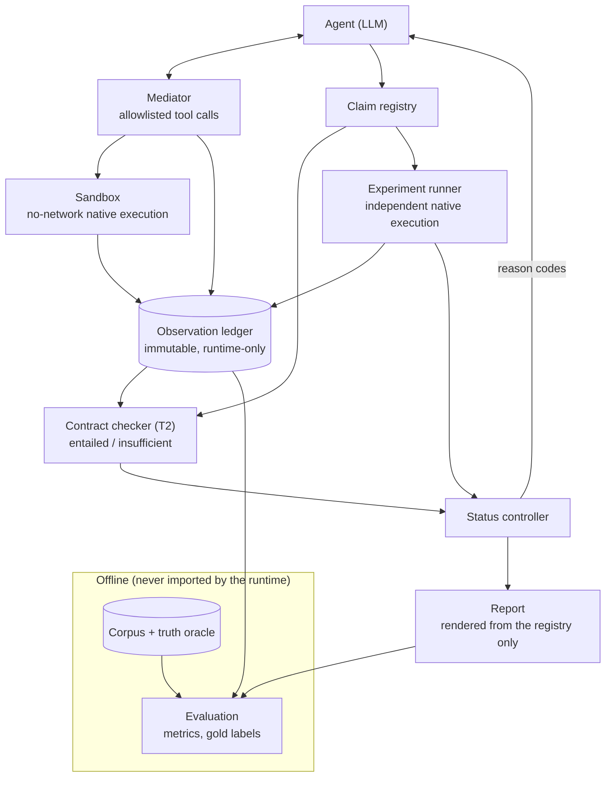

# EGRE — Evidence-Grounded Agentic Reverse Engineering

**Does an LLM reverse-engineering agent's conclusion actually follow from the evidence it
retrieved — and how does that differ from whether the conclusion is true?**

EGRE is a final-year research-engineering project that wraps an LLM agent doing binary
reverse engineering in a fully deterministic, offline-auditable harness. The agent
investigates a stripped function and submits a typed claim ("this function implements
CRC-32"), citing the observation handles it says support it. A separate, deterministic
checker then decides — independently of the agent and independently of ground truth —
whether the *cited* evidence actually entails the claim, while a native experiment settles
the question of whether the claim is *true*. The project measures how often those two
judgments agree and disagree.

No paid API key is required anywhere in this repository. The only real-model run uses a local
model served by [Ollama](https://ollama.com).

## Central question

> In LLM-agent reverse engineering, how often are the agent's conclusions entailed by the
> observations it obtained, how does that differ from whether they are true, and can a
> claim-type-specific evidence gate with active verification raise the share of conclusions
> that are both supported and true, without collapsing coverage?

Full hypotheses, success thresholds, and scope are in [docs/PROJECT_SPEC.md](docs/PROJECT_SPEC.md).

## Architecture

One LLM agent; everything else is deterministic Python. The agent never writes to the
evidence ledger directly, never decides a verdict, and never decides the truth of its own
claim — only the independent contract checker and the native experiment runner do.



| Component | Responsibility |
|---|---|
| **agent** | Single ReAct-style LLM loop. Submits/revises/retracts typed claims. |
| **llm** | Provider-neutral client interface: fake client for tests, a real OpenAI-compatible adapter. |
| **mediator** | Allowlisted, schema-validated tool calls (`disassemble`, `read_memory`, `run`). No raw shell, no network. |
| **sandbox** | No-network execution wrapper (`sandbox-exec`) around native tools. |
| **ledger** | Append-only observation record, written only by the runtime — never the agent. |
| **claims** | Typed claim schema and registry. |
| **contracts** | Deterministic, per-claim-type evidence rule (T2: hash-primitive identification). |
| **runner** | Builds and executes the independent verification experiment; result is logged to the ledger. |
| **controller** | Combines contract result + experiment verdict into claim status; produces reason-code feedback. |
| **report** | Renders a report **only** from the claim registry — no free-text leakage. |
| **corpus** *(offline)* | Synthetic program generator, build matrix, truth oracle. |
| **evaluation** *(offline)* | Metrics, gold-label tooling. Never imported by runtime code (checked by a dedicated test). |

### Invariants

| | |
|---|---|
| I1 | The agent cannot write the ledger; an unknown evidence handle fails closed. |
| I2 | No LLM decides a contract result, an experiment verdict, or a truth value. |
| I3 | A harness failure is always `inconclusive`, never `refuted`. |
| I4 | The report is rendered only from the claim registry. |
| I5 | Runtime packages never import corpus-generation or evaluation code. |
| I6 | Support (evidence-based) and truth (oracle-based) are computed independently. |

## Repository layout

```text
src/egre/
  agent/        bounded JSON-action loop, deterministic scripted policies (P1-P3)
  mediator/     allowlisted tools: disassemble, read_memory, run
  ledger/       append-only observation store, constant extraction (ARM64 mov/movk)
  claims/       claim schema, registry
  contracts/    T2 evidence contract (signature-constant / behavioral-match rules)
  runner/       native executor, independent verification runner
  controller/   status derivation, reason codes
  report/       registry-only report rendering
  llm/          provider-neutral client interface, OpenAI-compatible adapter, fake client
  cli/          `python -m egre.cli.run` -- drives a real local model end to end
  corpus/       synthetic hash-primitive program generator + build matrix
  evaluation/   metrics, support x truth matrix, gate views, offline demo
corpus/
  src/          7 C source programs (clean / decoy / obfuscated variants)
  truth/        human-owned ground-truth oracle (never read by runtime code)
  tasks/        agent-visible task files -- no truth fields
tests/          126 tests mirroring the src/ layout; toolchain-marked tests build and run
                real arm64 binaries (clang, codesign, Capstone)
docs/           specification, architecture, decisions, evaluation plan, results
```

## Quick start (native macOS, Apple Silicon)

No Docker, no Ghidra, no paid API key.

```bash
xcode-select --install
brew bundle                                   # python@3.11+, radare2 (optional)

python3.11 -m venv .venv && source .venv/bin/activate
pip install -e ".[dev,re]"

./scripts/check_env.sh                        # clang / strip / codesign / capstone / unicorn
./scripts/smoke_env.sh                        # confirms the no-network sandbox actually blocks network

python -m egre.corpus.build                   # builds the 7 signed arm64 Mach-O binaries
./scripts/verify.sh --full                    # ruff + mypy + all 126 tests
```

See [docs/SETUP.md](docs/SETUP.md) for the full prerequisites list and troubleshooting notes.

## Running the prototype demo (no model, no API key)

Runs three deterministic scripted policies over all seven corpus programs, checks each claim
against its cited observations, independently executes the binary on reference vectors, and
prints the support/truth matrix plus three gate views.

```bash
source .venv/bin/activate
python -m egre.demo
```

Expected output:

```text
Support x truth
support       true  false
entailed        14      3
insufficient     1      4

Gate views
view  claims  true  false  precision  coverage
C1        22    15      7      68.2%     71.4%
C2        17    14      3      82.4%     66.7%
C3        15    15      0     100.0%     71.4%
```

`C1` includes every submitted claim. `C2` keeps only claims the contract checker finds
mechanically entailed by their cited evidence. `C3` keeps only claims the independent
experiment confirmed. This single run demonstrates both of the project's central failure
modes: evidence support can preserve a false claim (`C2` still has 3 false claims), while a
correct claim can have no usable evidence citation at all (`C1`'s true-claim count exceeds
`C2`'s). The full verified-only gate (`C3`) removes every false claim in this corpus without
losing coverage. The command also writes the complete 21-run result to `runs/demo.json`.

## Running against a real local model (Ollama, no API key)

```bash
brew install ollama
ollama serve &
ollama pull qwen3.5:4b                        # or any OpenAI-tool-calling-capable local model

source .venv/bin/activate
export OPENAI_BASE_URL=http://localhost:11434/v1
export OPENAI_API_KEY=ollama                  # any non-empty string -- Ollama ignores it

python -m egre.cli.run --llm openai --model qwen3.5:4b --repeats 3 --out runs/my-run
python -m egre.evaluation.cli runs/my-run     # prints the support x truth table for the run
```

`--base-url` is checked against the local Ollama endpoint explicitly — the harness refuses to
run against any non-local address, so a real-model run can never accidentally reach a paid
endpoint.

The project's own 21-run pilot against `qwen3.5:4b` (7 programs × 3 repeats) is recorded in
full, with per-run traces, in [docs/RESULTS_PROTOTYPE.md](docs/RESULTS_PROTOTYPE.md):

```text
Support x truth
support       true  false
entailed         6      0
insufficient    17      2

Gate views
view  claims  true  false  precision  coverage
C1        25    23      2      92.0%     90.5%
C2         6     6      0     100.0%     23.8%
C3        23    23      0     100.0%     90.5%
```

The independent experiment (`C3`) removed both false claims from this pilot without any
coverage loss relative to `C1` — while the contract checker alone (`C2`) was also perfectly
precise, but kept only 6 of 25 claims, because the local model frequently inferred a primitive
from static bytes without ever gathering the behavioral evidence (`run` calls) the contract
requires.

## Testing

```bash
./scripts/verify.sh            # fast: ruff + mypy + tests that don't need the real toolchain
./scripts/verify.sh --full     # adds toolchain-marked tests (builds and runs real binaries)
```

## Prototype limitations

- The corpus contains seven benign, synthetic programs compiled for native macOS arm64 at
  `-O0`; it is not representative of production reverse-engineering workloads.
- Only one typed claim is evaluated: "the function at address A implements hash primitive P,"
  where P is CRC-32, FNV-1a, Adler-32, djb2, or `other`.
- Experiments execute the program natively under a no-network wrapper. This is function-level
  behavioral evidence, not instruction-level emulation.
- The demonstrated scripted policies (P1–P3) are deterministic; the one real-model pilot above
  used a local 4B-parameter model, not a frontier model, and is a small pilot, not a general
  claim about LLM reverse-engineering capability.
- Support is intentionally syntactic (a signature constant anywhere in cited disassembly, or
  2+ matching runs): a signature constant in dead code can support a false claim, and an
  obfuscated implementation can lose evidence coverage even when its claim is true
  (`support_gap`).

## Documentation

| Doc | Covers |
|---|---|
| [docs/PROJECT_SPEC.md](docs/PROJECT_SPEC.md) | Research question, hypotheses, scope, success thresholds. |
| [docs/ARCHITECTURE.md](docs/ARCHITECTURE.md) | Component responsibilities and invariants. |
| [docs/CLAIM_TAXONOMY.md](docs/CLAIM_TAXONOMY.md) | Claim types and evidence contracts. |
| [docs/EVALUATION_PLAN.md](docs/EVALUATION_PLAN.md) | Full evaluation design: conditions, metrics, thresholds. |
| [docs/RESEARCH_NOTES.md](docs/RESEARCH_NOTES.md) | Related work and how this project is positioned against it. |
| [docs/DECISIONS.md](docs/DECISIONS.md) | Numbered engineering decision log. |
| [docs/SETUP.md](docs/SETUP.md) | Full native macOS environment setup. |
| [docs/RESULTS_PROTOTYPE.md](docs/RESULTS_PROTOTYPE.md) | The real-model pilot: full results and manual run inspection. |
| [docs/STATUS.md](docs/STATUS.md) / [docs/TASKS.md](docs/TASKS.md) | Current state and task queue. |
