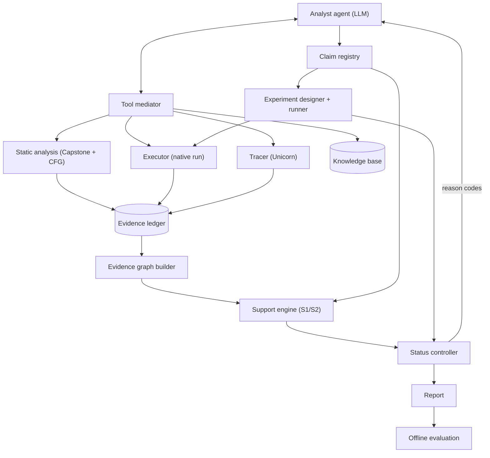

# EGRE — Project Overview

This is the single, structured explanation of the whole project: what it asks, how it's
built, what every piece does, and what's actually been found so far. [README.md](../README.md)
is the front door (quick start, commands); this document is the textbook.

It assumes no prior context. Where a claim is backed by a specific test or measurement in
this repository, it's named, so you can go check it yourself rather than take the document's
word for it.

---

## 1. The research question

> For an LLM agent doing reverse engineering, how often is a conclusion it states actually
> **entailed** by the evidence it retrieved — and how does that differ from whether the
> conclusion is **true**?

These are not the same question. A model can:

- **Be right by accident** — state a correct conclusion while citing evidence that doesn't
  actually establish it (or citing nothing at all).
- **Be wrong for a plausible-looking reason** — a decoy signature constant sitting in dead,
  unreachable code can look like solid evidence to a naive checker.
- **Be right, and know it, but not say why** — "post-rationalize": settle on an answer before
  gathering evidence, then cite evidence afterward that happens to be consistent with it,
  regardless of whether it was load-bearing in the actual decision.

Most prior work on reverse-engineering agents measures *task success* (did it get the right
answer, how far did it get). EGRE instead builds a **deterministic, offline-auditable checker**
that never looks at whether a claim is true, only at whether the evidence the agent itself
cited supports it — and separately measures truth and causal dependence on that evidence.
The gap between "the checker says supported" and "actually true" is the object of study, not
an inconvenience to average away.

### Hypotheses

| | |
|---|---|
| **H1** | Support (does cited evidence entail the claim?) and truth are only partially correlated. |
| **H4** | Contrastive, execution-qualified support (S2) removes supported-but-false claims on dead-branch decoys, without needing an experiment. |
| **H4b** | Structural evidence has a hard limit: a constant that is *executed* but *causally irrelevant* to the output still produces a structural-but-false claim — only behavioral evidence or an experiment catches this. |
| **H5** | A read-only graph-query tool reduces the "citation gap" (evidence the agent had but didn't cite) for a small model. |
| **H6** | Knowledge-base lookup helps form hypotheses, but families that share constants (FNV-1/FNV-1a, CRC-32/JAMCRC) make structural evidence genuinely ambiguous ("contested") in an open world; only behavioral evidence (actually running the binary) resolves them. |
| **H7** | Some claims that are supported and true are not actually *evidence-sensitive* — the model keeps its answer even when the cited evidence is swapped for a rival's. |

Full literature positioning and the specific papers this builds on or departs from are in
[RESEARCH_NOTES.md](RESEARCH_NOTES.md).

---

## 2. v1 → v2: what changed and why

**v1** (the prototype) asked a cruder version of the question: does a signature constant
*appear anywhere* in the cited disassembly? That rule has an obvious hole — it doesn't
distinguish a constant on the real execution path from one sitting in dead code, and it
doesn't notice when two rival algorithms share the same constant. Running v1's pipeline
against a real local model (`qwen3.5:4b` via Ollama, 21 scripted runs + a 21-run real-model
pilot) confirmed the hole was real: **17 of 23 true claims** came back "insufficient" support
under v1's rule, and that single label mixed three genuinely different failures (evidence
never gathered, evidence gathered but not cited, evidence cited but not actually supporting).
Full numbers: [RESULTS_PROTOTYPE.md](RESULTS_PROTOTYPE.md).

**v2** replaces "does the constant appear" with a graded, contrastive, execution-aware
definition of support (below), adds a real tracer so "executed" is a measurable fact rather
than an assumption, adds tools that let the agent ask about its own evidence instead of
guessing, and adds an open-world mode so "crc32 vs its look-alike jamcrc" is a real,
measurable ambiguity rather than invisible. [V2_SPEC.md](V2_SPEC.md) is the full specification
this was built from.

---

## 3. Core concepts

### 3.1 The claim

A claim is the unit the agent submits: *"the function at this address implements primitive
P"*, with a list of **evidence handles** it cites as support, and a confidence. Claim type is
currently T2 only (which hash primitive a function implements) — other claim types (data
semantics, input/output relations, conditional reachability) are explicitly out of scope for
now (see [CLAIM_TAXONOMY.md](CLAIM_TAXONOMY.md)). A `Registry` holds at most 3 claims per run,
and (v2) each claim can be **revised** up to twice or **retracted** (`src/egre/claims/schema.py`).

### 3.2 The evidence ledger

Every tool call the agent makes (`disassemble`, `read_memory`, `run`) is recorded as an
**observation** in an append-only ledger, each with a stable handle (`obs-000001`, …). The
agent cannot write to the ledger directly or edit a past observation — only the mediator can
append to it, and only through an allowlisted tool call. A claim can only cite handles that
exist in the ledger; an unknown handle fails closed (`src/egre/ledger/store.py`).

### 3.3 The evidence graph

A pure function of `(ledger, binary's control-flow graph)` — rebuilding it from the same
inputs always produces an identical graph (`src/egre/graph/evidence.py`). It has layers:

- **Program layer**: `fn:<addr>` the target function, `bb:<addr>` its basic blocks (from a
  Capstone-based CFG builder, `src/egre/graph/cfg.py`), `k:<value>@<addr>` a constant defined
  in a specific block.
- **Observation layer**: `obs:<handle>` nodes, `anchored_in` edges to every block an
  observation's address range overlaps.
- **Execution layer**: an `executed` edge from a `run` observation to a block, added only once
  a trace (below) confirms that block actually ran for that input.

### 3.4 The tracer — turning "executed" into a measured fact

`src/egre/tracer/emulate.py` emulates the target function in isolation using Unicorn (ARM64),
not the whole program: maps the binary's `__TEXT`/`__DATA_CONST` segments, places the input in
`x0`/`x1` per the AAPCS64 calling convention, sets the link register to an address no real
`ret` could reach so emulation stops exactly when the function returns, and records every
instruction address visited. Every `run()` call the agent makes is traced automatically
(`MediatorTools.run`); if the emulated output disagrees with the real native execution, the
trace is discarded and the native output is **never** altered (`tracer_mismatch`, never a
silent correction). `tests/tracer/test_emulate.py` asserts byte-exact agreement with native
execution across every reference vector for the original 7 programs; the newer 4 programs and
all `-O2` builds aren't covered by that dedicated test, but their correct `structural` S2
results throughout `tests/evaluation/test_metrics_v2.py`'s 22-binary table are strong indirect
evidence the tracer holds up across the full corpus too (a tracer mismatch there would show up
as a dropped-to-`none` tier, not a silently wrong one).

### 3.5 Support tiers: S0, S1, S2

The same evidence is scored under three modes side by side, specifically so the *gap between
modes* is itself a result:

| Mode | Rule | Where |
|---|---|---|
| **S0** | (v1, kept for comparability) A signature constant appears *anywhere* in the cited disassembly, or 2+ cited runs match the reference. | `egre.contracts.t2.check` |
| **S1** | **Contrastive.** A constant or a matching run counts only if no rival hypothesis is *equally or better* supported by the same evidence set. | `egre.support.engine.tier` |
| **S2** | **S1 + execution-qualified.** A disassembly constant counts only if the block holding it was actually entered by some traced run — a constant in dead code no longer counts at all, regardless of rivals. | `egre.support.engine.tier_s2` |

Tier order, worst to best: `contradicted < none < contested < structural < behavioral`.

- `contradicted`: some cited evidence disagrees with the claim outright.
- `behavioral`: a run's actual output matches, *and every rival is contradicted* by some run.
- `structural`: a disassembly constant supports the claim, *and no rival is supported without
  also being contradicted*.
- `contested`: the claim is supported, but so is at least one rival, and neither is
  contradicted — genuinely ambiguous evidence.
- `none`: nothing in the cited evidence supports the claim.

**Available vs. cited.** The same tier computation runs twice per claim: once over only the
handles the agent *cited*, once over *everything in the ledger*. If the available tier is
better than the cited tier, that's a `citation_gap` — evidence the agent had access to but
didn't use.

### 3.6 Reason codes — what gets sent back to the agent

`egre.controller.status_v2.reason_codes` turns a claim's tier computation into actionable
codes: `NO_CITATION`, `UNKNOWN_HANDLE`, `ANCHOR_MISMATCH`, `NO_SUPPORTING_EVIDENCE`,
`CONTESTED_BY:<rival>`, `CONTRADICTED_BY:<handle>`, `STRUCTURAL_ONLY`,
`EVIDENCE_AVAILABLE_NOT_CITED`, and two S2-specific ones: `UNEXECUTED_EVIDENCE` (a trace
exists somewhere, but not for this block) and `UNQUALIFIED_EVIDENCE` (no trace exists at all,
so execution can't be checked either way). When the evidence graph is available, reason codes
are computed with **S2**, not S0/S1 — so the agent is never told "contested" about a
dead-branch constant that execution has already resolved.

### 3.7 Status and verdict — kept independent of support on purpose

Support (above) answers "is the cited evidence good?" **Status** answers a completely
different question: "did an experiment confirm it?" — and status comes *only* from
`egre.runner.verify`/`egre.runner.experiment` actually executing the real binary, never from
the LLM and never from the support tier. A harness failure (timeout, crash) is always
`inconclusive`, **never** `refuted` — a broken test harness must not look like a
disproven claim. This separation is why a claim can be `verified` (the experiment confirmed
it) while its cited tier is only `contested` (a `support_gap` flag) — the project's central
example of a claim that's true but not well-justified.

### 3.8 Flags

Four booleans computed per claim (`egre.controller.status_v2.ClaimFlags`):
`support_gap` (verified, but cited tier ≤ contested), `citation_gap` (available tier beats
cited tier), `self_contradicted` (the full ledger contradicts the claim, even if the cited
subset doesn't), `post_hoc` (temporal proxy, below).

### 3.9 Post-hoc detection and the counterfactual probe

Two different, complementary proxies for "did the agent actually reason from this evidence,
or decide first and cite afterward?":

- **Temporal proxy** (`detect_post_hoc`, online): under R1's schema-constrained output, every
  step declares a `hypotheses` confidence map. If the claimed primitive was already the
  model's top, confident (≥0.7) hypothesis *before* any cited evidence existed in the ledger,
  that's flagged `post_hoc`. A proxy, not proof.
- **Counterfactual probe** (`egre.evaluation.counterfactual`, offline, H7): rebuilds the
  *exact* message context recorded at the step a claim was submitted, then either swaps the
  cited evidence for a rival's (run outputs become `ref_rival(x)`; disassembly facts become
  the rival's signature constants) or strips it out entirely, and re-queries the same model 3
  times. `evidence_sensitive` = switched to the rival in ≥2/3 replies. The model is tested
  here, never a judge — nothing it says changes any claim's tier, status, or verdict.

---

## 4. Architecture, component by component

| Component | Responsibility | Module |
|---|---|---|
| Analyst agent | The **only** LLM in the system. Investigates, submits/revises/retracts claims. | `egre.agent.loop` |
| Tool mediator | Validates and executes every tool call, logs it, returns a compact view. Agent never gets raw ledger access. | `egre.mediator.tools` |
| Static analysis | Capstone disassembly of the target function; CFG via leader-based basic-block splitting; constant extraction (handles ARM64's split `movz`/`movk` 32-bit immediates). | `egre.graph.cfg`, `egre.ledger.constants` |
| Executor | Native execution under a no-network sandbox; its output *is* the evidence. | `egre.runner.executor` |
| Tracer | Unicorn ARM64 emulation of just the target function; basic-block coverage. | `egre.tracer.emulate` |
| Knowledge base | `kb/algorithms.json`: signature constants, parameters, public test vectors for known algorithms. Read-only; never evidence (§6). | `egre.knowledge.kb`, `egre.knowledge.refs` |
| Evidence graph builder | Pure function of (CFG, ledger); the single source other components query. | `egre.graph.evidence` |
| Support engine | S1/S2 tiers, contrastive rivalry, execution qualification; works in closed or open world via injectable signature/reference maps. | `egre.support.engine` |
| Experiment designer + runner | Picks inputs that maximize distinct predicted outputs across live candidates (never copying the KB's own public vectors); combines them with held-out vectors for the final verdict. | `egre.runner.experiment`, `egre.runner.verify` |
| Status controller | Status/flags/reason codes from the verdict and support tiers. | `egre.controller.status_v2` |
| Report | Rendered **only** from the claim registry, with a per-claim Mermaid evidence subgraph. | `egre.report.render`, `egre.report.subgraph` |
| Offline evaluation | Truth join, deduplication, gate views, rates, re-scoring, counterfactual probe — never imported by runtime code. | `egre.evaluation.*` |

---

## 5. The corpus

22 binaries (11 programs × `-O0`/`-O2`), native Apple Silicon Mach-O, stripped and ad-hoc
re-signed, built from `corpus/catalog.json` by `egre.corpus.build`. Every program wraps a
`target(buf, len) -> uint32_t` function.

| Program | Truth | What it tests |
|---|---|---|
| `crc32_clean`, `fnv1a_clean`, `adler32_clean`, `djb2_clean` | respectively | A clean, undisguised implementation of each closed-world primitive. |
| `fnv1a_crcdecoy` | fnv1a32 | FNV-1a with the CRC-32 polynomial sitting in a dead, unreachable branch — the project's central decoy case. |
| `djb2_fnvdecoy` | djb2 | djb2 with FNV-1a's constants in a dead branch. |
| `crc32_obfpoly` | crc32 | Real CRC-32, but the polynomial is computed at runtime — the constant never appears literally, so structural evidence is unavailable even though the claim is true (`support_gap`). |
| `fnv1_clean` | fnv1_32 | Shares **both** constants with FNV-1a (by design) — structural evidence alone can't tell them apart; resolved as `contested` in open-world mode. |
| `jamcrc_clean` | jamcrc | Same polynomial and init as CRC-32, no final inversion — same shared-constant ambiguity. |
| `crc32c_clean` | crc32c | Same structure as CRC-32, different (Castagnoli) polynomial — a genuinely distinguishable rival. |
| `sdbm_execdecoy` | sdbm | No distinctive constant of its own, **plus** a `volatile`-forced, *executed* CRC-32 constant that never affects the output — tests whether execution-qualification alone (without an experiment) is enough (it isn't: H4b). |

At `-O2`, the compiler proves `fnv1a_crcdecoy`'s and `djb2_fnvdecoy`'s dead branches
genuinely unreachable and removes them outright — confirmed empirically
(`tests/evaluation/test_metrics_v2.py`), which is itself a finding: a plain dead-branch decoy
is an `-O0`-only phenomenon; `sdbm_execdecoy`'s tag constant is marked `volatile` specifically
so it survives optimization and keeps testing H4b at both levels.

**Held-out vectors** (`corpus/held_out_vectors.json`) are a second input set, never published
anywhere a program's output could be tuned against, used only by the experiment runner
(`egre.runner.experiment`) for the final verdict — never exposed through any agent-facing
tool or prompt (checked by `tests/test_boundaries.py`).

---

## 6. The knowledge base and open-world mode

`kb/algorithms.json` ships **10 validated entries**: `crc32`, `jamcrc`, `crc32c`, `adler32`,
`fletcher32`, `fnv1a32`, `fnv1_32`, `djb2`, `murmur3_32`, `jenkins_one_at_a_time`. Each entry's
signature constants were checked against either a published check value or (for `crc32`,
`adler32`, `fnv1a32`, `djb2`) v1's own independent cross-checks.

**Three candidate entries were deliberately excluded, not guessed**: `elf_hash` disagreed with
a secondary source on every multi-byte input tried (a real, unresolved discrepancy, not just
missing data); `sdbm` and `djb2a` had their *formulas* confirmed against an authoritative
source but no numeric check value anywhere. This is a direct instance of the project's own
rule — "entries that fail validation are excluded, not guessed" — applied to itself.

`egre.knowledge.kb.lookup_knowledge` does lexical retrieval only (exact constant-value match,
or substring match over name/alias/description) — deliberately not an embedding index, since
the KB is small and exact constants matter more than semantic similarity. **Knowledge is never
evidence (invariant I7, below)**: `lookup_knowledge` never writes to the ledger, so its
`K-<id>` handles are not valid observation handles — citing one in a claim fails closed with
the same `UnknownHandleError` any made-up handle would get. This is enforced by construction,
not a special-cased check.

**Open-world mode** (R4) just means `support/engine.py`'s `tier()`/`tier_s2()` run with the
KB's 10 entries as the candidate set instead of the closed-world 4
(`egre.knowledge.kb.open_world_candidates`/`open_world_signatures`). Nothing else changes —
the same contrastive logic now sees `fnv1_32` as a live rival to `fnv1a32`, which is exactly
what reveals the shared-constant ambiguity: on the real corpus, `crc32_clean`'s own claim
(real crc32, cited structurally) is `contested` in open world too, because `jamcrc` shares its
polynomial — a true claim with genuinely ambiguous structural evidence, which only an
experiment or a behavioral (run-based) claim resolves.

---

## 7. Agent tools and conditions (R0 → R4)

| Tool | Added in | What it does |
|---|---|---|
| `disassemble`, `read_memory`, `run` | v1 | The original three evidence-gathering tools. `run` now auto-traces (§3.4). |
| `query_graph` | R2 | Three fixed, **read-only** queries: `constants_in` (only constants the agent has *already* surfaced via `disassemble` — never the full static binary for free), `executed_blocks`, `observations`. Never adds or changes a citation (I8) — verified directly: calling every query repeatedly changes nothing about the ledger. |
| `revise_claim` / `retract_claim` | R3 | Up to 2 revisions per claim (`Registry.MAX_REVISIONS`); each submission/revision returns fresh `reason_codes` so the agent can close a specific gap. |
| `lookup_knowledge` | R4 | §6. |

| Condition | Adds | CLI flag(s) |
|---|---|---|
| R0 | v1 baseline agent | *(none)* |
| R1 | Schema-constrained output: every action also carries a `hypotheses` confidence map | `--hypotheses` |
| R2 | R1 + `query_graph` | `--hypotheses --query-graph` |
| R3 | R2 + reason-code feedback loop | `--hypotheses --query-graph --revision` |
| R4 | R2 + `lookup_knowledge`, open world | `--hypotheses --query-graph --knowledge` |

`--hypotheses` works via a system-prompt instruction plus post-hoc validation regardless of
provider; `--structured-output` additionally sends an OpenAI-style `response_format` JSON
schema, which not every local backend supports (some return `HTTP 501`) — found empirically
while preparing V-20's real-model run.

---

## 8. Evaluation framework

### 8.1 Gate views

Applied to a batch of runs (`egre.evaluation.metrics_v2`), each a different trade-off between
coverage and precision:

| View | Keeps a claim if | What it answers |
|---|---|---|
| **C1** | always | Every claim, unfiltered. |
| **C2s** | cited tier ≥ `structural` | Passive gate, structural evidence allowed. |
| **C2b** | cited tier == `behavioral` | Passive gate, behavioral evidence only. |
| **C3** | status == `verified` | Only experimentally confirmed claims. |
| **J** | verified **and** cited tier ≥ `structural` | "Justified and true" — the strongest combined bar. |

### 8.2 What the deterministic scripted-policy table found (V-18)

Four hand-written deterministic policies (P1 grepper, P2 emulator, P3 prior-guesser, P4
trace-qualified grepper) were run against all 22 binaries (88 runs, 74 claims) as a
ground-truth sanity check before spending model-inference time. Pinned exactly in
`tests/evaluation/test_metrics_v2.py`. Findings:

- **P1/P3 never call `run()`**, so nothing is ever execution-qualified — their S2 cited tier
  is `none` on every single claim, even where S1 found `structural` or `contested` support.
  This is the mechanism working as designed, not a weakness: S1 alone cannot tell "present"
  from "present and live."
- **P2/P4 are unaffected by, or actively resolve, the gap.** P4 (run once, then cite only
  constants `query_graph` confirms are executed) upgrades every S1-`contested` case
  (`fnv1a_crcdecoy`, `djb2_fnvdecoy`) to S2-`structural`.
- **On this corpus, S2 never leaves a claim `contested`** — it either fully resolves the
  ambiguity (P4) or finds nothing qualified at all (P1/P3, dropping straight to `none`).
- **C3 and J both reach 100% precision independently** on this corpus (zero false claims in
  either view) — the experiment verdict and the "verified + structural-or-better" floor are
  each, on their own, a strong enough guarantee here. (Small corpus; not a general claim.)

### 8.3 Re-scoring the v1 pilot under S2

Retroactively replay-tracing the frozen `qwen3.5:4b` pilot run's recorded inputs
(`egre.evaluation.rescoring.rescore_document_with_s2`) found **more** of the "supported but
not really" gap than S0/S1 alone: **4 of 25 claims** that were S0-entailed drop to
≤`contested` under S2 (vs. only 1 under S1), and **3 claims** that looked clean under S1
(`structural`/`behavioral`, no live rival) turn out to cite a block the model's own recorded
runs never actually executed.

### 8.4 Rates and the counterfactual probe

Beyond the gate views, `summarize_v2` reports citation-gap rate, self-contradiction rate,
contested rate, and reason-code counts — overall, per program, and per catalog variant
(clean/decoy/obfuscated). `post_hoc_rate` is reported as `None`, not `0`, whenever no claim in
the group carries real hypothesis-step data (true for every scripted-policy run; only R1+
model runs have it). §3.9 covers the counterfactual probe.

---

## 9. Invariants

Enforced by construction or by a dedicated test, not just by convention:

| | Invariant |
|---|---|
| **I1** | The agent cannot write the ledger; an unknown handle fails closed. |
| **I2** | No LLM decides a verdict or a truth value. |
| **I3** | A harness failure is `inconclusive`, never `refuted`. |
| **I4** | The report is rendered only from the claim registry. |
| **I5** | Runtime packages (`agent`, `mediator`, `ledger`, …) never import `corpus` or `evaluation` code — checked by AST analysis in `tests/test_boundaries.py`, not just a docstring. |
| **I6** | Support and truth are computed independently. |
| **I7** | Knowledge never counts as evidence: no support path passes through a knowledge node; a `K-<id>` handle can never be cited. |
| **I8** | The system never cites for the agent: `query_graph` is read-only. |
| **I9** | The evidence graph is a pure function of `(ledger, binary, KB)`: rebuilding it gives an identical graph. |
| **I10** | Held-out verdict vectors are never exposed through any tool, the agent loop, or a prompt — `egre.runner.experiment` is the one module allowed to read that file, checked by `tests/test_boundaries.py`. |
| **I11** | The counterfactual probe runs entirely offline; the LLM is the subject being tested, never the judge. |

---

## 10. Current status

19 of 20 v2 tasks are complete (V-01 through V-19): the full engine (CFG, evidence graph, S1
and S2 support, tracer, status/reason codes), every agent tool and condition (R1–R4), the
knowledge base, the experiment designer, v2 metrics, and the counterfactual probe — all built,
tested (329 tests), and committed.

**One task remains, V-20**: run the real local model across all four agent conditions
(R1–R4), re-score every run under S0/S1/S2, run the counterfactual probe on claims with cited
tier ≥ structural, and write up `docs/RESULTS_V2.md`. This is explicitly machine-time and
human-owned — see [STATUS.md](STATUS.md) and [TASKS.md](TASKS.md) for the exact state and the
run checklist.

---

## 11. Known limitations

- **One claim type.** Only T2 ("which hash primitive does this function implement") is
  implemented. Data semantics, input/output relations, and conditional reachability (T3–T5 in
  the original taxonomy) are explicitly out of scope for this phase.
- **Small, synthetic corpus.** 11 programs (22 binaries), all short hash/checksum functions.
  Results here are a pilot, not a claim about reverse-engineering agents in general — every
  number in this project is reported with its sample size.
- **Memory-table evidence is always neutral.** `read_memory` observations never count as
  support in S1/S2 (v2 limitation): cross-referencing memory against data tables isn't
  implemented.
- **No symbolic execution, no Ghidra, no angr, no Docker** — deliberate scope cuts
  ([DECISIONS.md](DECISIONS.md)), not oversights.
- **Local-model inference is slow and memory-hungry** on constrained hardware. Discovered
  while preparing V-20: Ollama has no hard RAM cap, and MLX-backed model builds in particular
  don't support the memory-reducing flags (KV-cache quantization, flash attention) that the
  GGUF/llama.cpp backend does — a genuinely architectural limitation on 8GB machines, not a
  configuration bug.
- **The counterfactual probe doesn't edit disassembly text in place.** An early version tried
  to rewrite hex constants directly in assembly text for the "swap evidence" variant; ARM64
  splits 32-bit constants across `movz`/`movk`, and naive substring replacement of one of
  those small hex halves collided with and corrupted an unrelated instruction's address during
  testing. Fixed by replacing the whole content field with an explicit
  `[counterfactual: ...]` label instead of attempting a text edit — documented in
  `egre.evaluation.counterfactual` as a deliberate design choice, not a missing feature.
