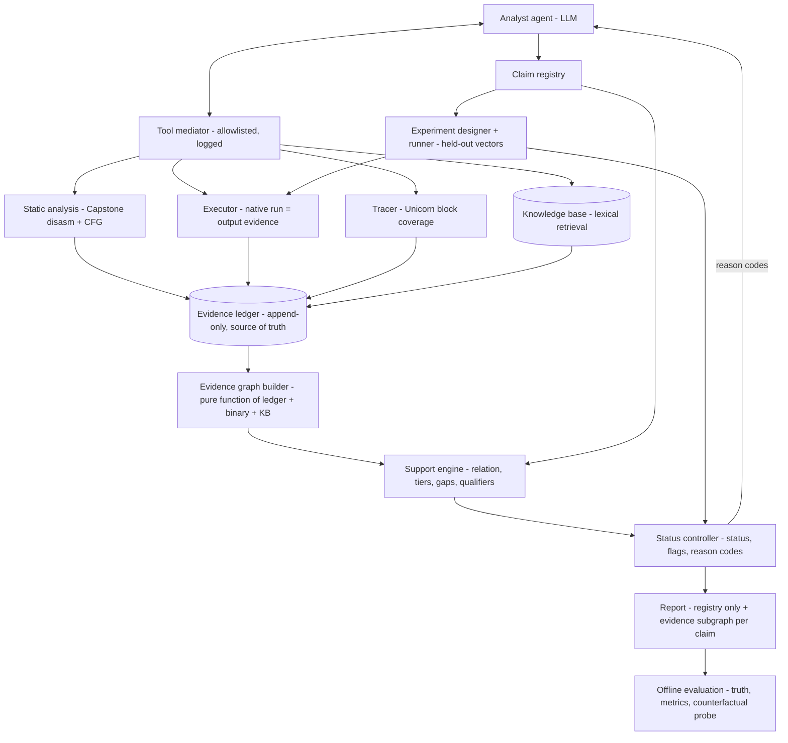

# EGRE v2 — Evidence quality, not just evidence presence

Development spec for the next phase of the Evidence-Grounded Agentic Reverse Engineering (EGRE) project. It builds on the working v1 prototype. Give this file to a new chat together with `egre-project-context.md` (the history of v1).

**How a new chat should use this file**
1. Read `egre-project-context.md` first (what v1 is, what ran, what the numbers were).
2. Read this file. It is the source of truth for v2 scope, definitions and order of work.
3. Before planning code, inspect the real repository (`src/egre/`, `docs/PROTOTYPE.md`, `docs/TASKS.md`). Module names below follow v1's `PROTOTYPE.md`, but the actual code may differ. Adapt to the code, not the other way round.
4. Development uses OpenAI Codex in a loop (one task per iteration, `./scripts/loop.sh`, `verify.sh` gate, protected files). Produce copy-paste Codex prompts per task when asked.
5. Suggested repo placement: save this file as `docs/V2_SPEC.md` (protected), archive v1's queue as `docs/TASKS_PROTOTYPE.md`, and create a new `docs/TASKS.md` from section 8.

---

## 1. Summary

v1 checked whether an agent's cited evidence *contained* something that matched its claim. The pilot with a local 4B model (`qwen3.5:4b`, 21 runs) showed that this is too blunt:

- 17 of 23 true claims were marked `insufficient`, and that label mixed three different failures: evidence never gathered, evidence gathered but not cited, evidence cited but not supporting.
- The v1 constant rule accepts a signature constant anywhere in the function, including dead code, so a constant-matching agent produced supported-but-false claims on the decoy programs (3 in the scripted demo).
- v1 cannot tell whether a citation was actually used or attached afterwards (post-rationalization).

v2 measures **evidence quality**:

1. **Contrastive support**: evidence supports a claim only if it favours the claim over the rival answers. Evidence that fits several answers is `contested`; evidence that disagrees is `contradicted`.
2. **Evidence strength tiers**: behavioural evidence (input/output runs that eliminate rivals) is stronger than structural evidence (signature constants).
3. **Execution qualification**: a constant counts as structural evidence only if the code that holds it actually ran in one of the agent's own runs.
4. **Availability vs citation vs faithfulness**: for each claim, measure what evidence the agent *had*, what it *cited*, and whether it *depended on* it.
5. **An evidence graph** that makes all of this a deterministic query, and a per-claim evidence subgraph for explanation.
6. **A small knowledge base with lexical retrieval (RAG)** that helps the agent form hypotheses, but which can never count as evidence about the binary.

Everything stays native on Apple Silicon macOS (Mach-O arm64), with no Ghidra and no Docker. Claim type stays T2 (which algorithm does this function implement).

---

## 2. Research questions and hypotheses

Central question (v2 form): *For an LLM reverse-engineering agent, how often is a conclusion (a) backed by evidence the agent actually obtained, (b) backed by what it cited, (c) causally dependent on that evidence, and (d) true — and do contrastive, execution-qualified support rules separate justified conclusions from lucky or misled ones?*

| ID | Hypothesis | How it is tested |
|---|---|---|
| H1 | Support and truth are only partially correlated (carried over from v1) | support x truth matrix per condition |
| H4 | Contrastive + execution-qualified support removes supported-but-false claims on dead-branch decoys under passive gating, without experiments | scripted policies, deterministic; then real-model runs |
| H4b | Structural evidence has a hard limit: an *executed but irrelevant* constant still yields structural-but-false claims; only behavioural evidence (or experiments) removes them | `sdbm_execdecoy` program; views C2s vs C2b |
| H5 | A read-only graph query tool reduces the citation gap (evidence available but not cited) for a small model | R1 vs R2 |
| H6 | Knowledge retrieval raises answer accuracy in an open candidate set, but shared-constant families (FNV-1/FNV-1a, CRC-32/JAMCRC) make structural evidence contested; only behavioural evidence resolves them | R4 open world, shared-constant programs |
| H7 | Some supported, true claims are not evidence-sensitive: the model keeps its answer even when the cited evidence is swapped for a rival's (post-rationalization) | offline counterfactual probe |

Null or negative results are reportable. The pilot is small; report counts and intervals, not significance.

**Positioning (do not overclaim)**
- Reachability levels and provenance grouping already exist in RARE-Bench/RARE-Guard (arXiv 2607.12507).
- Citation correctness vs citation faithfulness and "post-rationalization" come from RAG research (Wallat et al., arXiv 2412.18004; a 2026 reproduction, arXiv 2609.23053, found answer-correctness training did not fix it).
- Constant-signature crypto detection (FindCrypt, Signsrch) is known to be fragile; semantic identification (data flow, symbolic execution, emulation) is more robust (see arXiv 2608.25122 related work). Removing constants on infeasible paths as a false-positive refinement has precedent (CryptoGuard, arXiv 1806.06881).
- What is new here is the combination for tool-using RE agents: contrastive, execution-qualified support tiers; the availability / citation / faithfulness split measured against ground truth; and a hard separation between retrieved knowledge and evidence.

---

## 3. Core definitions (normative)

### 3.1 Hypothesis set H
- **Closed world**: H = the candidate list in the task file (v1: crc32, fnv1a32, adler32, djb2) plus `other`.
- **Open world**: H = all knowledge-base entries plus `other`.

### 3.2 Evidence relation rel(o, h) ∈ {SUPPORTS, CONTRADICTS, NEUTRAL}
Deterministic, computed for each observation `o` anchored to the target function and each hypothesis `h`:

- **Run observation** (the agent ran the program on input x and got output y, execution completed): SUPPORTS if `y == ref_h(x)`, otherwise CONTRADICTS.
  - Note: some inputs do not discriminate (e.g. FNV-1 and FNV-1a agree on the empty input). The tier rules below handle this automatically.
- **Disassembly observation** containing signature constant k of h:
  - SUPPORTS (structural) if k's basic block was **executed** in at least one traced run in the ledger;
  - NEUTRAL with qualifier `UNEXECUTED` if traces exist and the block never ran;
  - NEUTRAL with qualifier `UNQUALIFIED` if no trace exists (scoring mode S1 treats `UNQUALIFIED` as SUPPORTS, for comparability; S2 does not).
  - Absence of a constant is always NEUTRAL, never CONTRADICTS (obfuscation, e.g. `crc32_obfpoly`).
- **Memory observation**: NEUTRAL in v2 (documented limitation; data-table support needs cross-reference analysis).
- **Knowledge observation** (from the knowledge base): never takes part in rel. It is not evidence (invariant I7).

### 3.3 Support tier of claim h given an evidence set E
Ordered: `contradicted` < `none` < `contested` < `structural` < `behavioral`.

- `contradicted`: some o in E CONTRADICTS h.
- `behavioral`: some run o in E SUPPORTS h, and every rival r in H \ {h} is CONTRADICTED by some run in E.
- `structural`: some disassembly o in E SUPPORTS h, and no rival r is SUPPORTED by E without also being CONTRADICTED by E.
- `contested`: h is SUPPORTED by E, but at least one rival is also SUPPORTED by E and not CONTRADICTED.
- `none`: nothing in E supports h (and nothing contradicts it).
- Claim `other` is `behavioral` if every member of H \ {other} is CONTRADICTED by runs in E.

This replaces v1's rules (a)/(b). v1's "at least two runs" rule becomes the principled "rivals eliminated" rule.

### 3.4 Cited tier, available tier, and the gaps
- **Cited tier** = tier(h, E_cited), where E_cited are the observations the agent cited.
- **Available tier** = tier(h, L_f), where L_f is every observation in the ledger anchored to the target function (everything the agent obtained).
- `citation_gap` flag: available tier > cited tier.
- `self_contradicted` flag: available tier is `contradicted` (the agent ignored its own counter-evidence).

### 3.5 Faithfulness (two measures, both reported as proxies)
- **Temporal proxy (online, `post_hoc` flag)**: in conditions with structured output, every agent step emits a `hypotheses` list with confidences. `post_hoc` = the claimed h was the agent's top hypothesis (confidence ≥ 0.7) at a step before any observation supporting h existed in the ledger, and the claim cites only evidence obtained after that step. This is a proxy, not proof.
- **Counterfactual probe (offline, H7)**: for each deduplicated final claim with cited tier ≥ structural, rebuild the exact model context at the claim step, then replace the cited evidence with a rival's evidence (run outputs replaced by `ref_rival(x)`; signature constants replaced by the rival's). Query the same model 3 times at temperature 0 (or fixed seeds). The claim is **evidence-sensitive** if it switches to the rival in at least 2 of 3; otherwise **evidence-insensitive**. Also run a "cited evidence removed" variant. The model is the *subject* of this test, never a judge, so invariant I2 holds.

### 3.6 Verdict, status and flags
- **Verdict** (experiment runner): `confirmed` if the binary's outputs match `ref_h` on every **held-out** vector plus every designed discriminating input; `refuted` if execution succeeded and any output differs; `inconclusive` on any execution failure (never refuted on failure).
- **Status**: `refuted` | `verified` | `unverified` (verdict inconclusive). Support is reported separately as cited tier and available tier.
- **Flags**: `support_gap` (verified, cited tier ≤ contested), `citation_gap`, `self_contradicted`, `post_hoc`.

### 3.7 Gate views (for evaluation)
- **C1** all claims
- **C2s** cited tier ≥ structural (passive, structural allowed)
- **C2b** cited tier = behavioral (passive, behavioural only)
- **C3** verified (experiment)
- **J** (justified and true) verified and cited tier ≥ structural

Coverage of a view = share of runs that keep at least one true claim. Claims are deduplicated per (run, function, hypothesis), keeping the latest revision.

### 3.8 Reason codes (returned to the agent and counted in evaluation)
`NO_CITATION`, `UNKNOWN_HANDLE`, `ANCHOR_MISMATCH`, `NO_SUPPORTING_EVIDENCE`, `UNEXECUTED_EVIDENCE`, `UNQUALIFIED_EVIDENCE`, `CONTESTED_BY:<h>`, `CONTRADICTED_BY:<handle>`, `STRUCTURAL_ONLY`, `EVIDENCE_AVAILABLE_NOT_CITED`.

---

## 4. Architecture



### 4.1 Components

| Component | Responsibility | Notes |
|---|---|---|
| Analyst agent | Investigates, submits typed claims with its own citations, may revise after reason codes | Only LLM in the runtime. Structured output (JSON schema) in R1+ |
| Tool mediator | Validates, executes, logs every call; returns compact views + handles | `query_graph` is read-only; knowledge lookups are logged as knowledge, not evidence |
| Static analysis | Capstone disassembly of the target function; basic-block split; constant extraction (`mov`/`movk` reconstruction from v1) | No Ghidra |
| Executor | Native run under `sandbox-exec` (no network), timeout; its output is the evidence value | Unchanged from v1 |
| Tracer | Unicorn ARM64 emulation of the target function to get executed basic blocks | Every agent `run` is also traced automatically; coverage attaches to that run observation. If tracer output ≠ native output, record `tracer_mismatch` and drop coverage; never change the output |
| Knowledge base | `kb/algorithms.json`: algorithm entries with signature constants, parameters, short descriptions, **public** test vectors | Human-owned, read-only. Held-out vectors are stored separately and never exposed (I10) |
| Evidence graph builder | Rebuilds the graph after every step | networkx in memory, JSON export; no graph database |
| Support engine | Implements section 3 (rel, tiers, cited vs available, qualifiers, temporal proxy) | Deterministic. Scoring modes S0 (v1 rules), S1 (contrastive, unqualified constants allowed), S2 (contrastive + execution-qualified) |
| Experiment designer + runner | Chooses inputs that split live hypotheses (max distinct predicted outputs); runs held-out + designed vectors; returns verdict | Designed inputs are generated, not taken from the public KB vectors |
| Status controller | Status, flags, reason codes; feedback to agent (R3) | |
| Report | Rendered only from the registry; includes a Mermaid evidence subgraph per claim (claim → cites → observation → anchored block → executed-by run) | Good for demos and the write-up |
| Offline evaluation | Truth join, dedup, tiers by scoring mode, views, coverage, counterfactual probe | Never imported by runtime code |

### 4.2 Evidence graph schema

| Layer | Node ids | Edges |
|---|---|---|
| Program | `fn:<addr>`, `bb:<addr>`, `ins:<addr>`, `k:<value>@<addr>` | `contains`, `cfg_next`, `defines_constant` |
| Execution | `run:<handle>` (input, output, coverage) | `executed` (run → bb), `produced` |
| Observation | `obs:<handle>` (disasm, memory, run, trace, knowledge) | `anchored_in` (obs → fn/bb), `derived_from` |
| Knowledge | `kb:<id>` (signature constants, parameters) | `predicts` (kb → constant value). **No edge from knowledge may take part in a support path** |
| Claims and experiments | `claim:<id>`, `exp:<id>` | `cites` (claim → obs), `tests` (exp → claim), `confirms` / `refutes` |

### 4.3 Agent tools (v2)
- `disassemble(addr, count)` — unchanged.
- `read_memory(addr, n)` — unchanged.
- `run(input_hex)` — native output (evidence) + automatic trace (coverage).
- `query_graph(query, args)` — fixed, read-only queries only: `constants_in(function)` (constants with block id, execution status, observation handles), `executed_blocks(function)`, `observations(function, kind?)`. Returns handles; never computes support for the agent and never compares outputs to references.
- `lookup_knowledge(query)` — exact match on constant values, or simple keyword match over names/aliases/descriptions; returns public KB fields with `K-` handles. Lexical retrieval is deliberate: the KB is small and exact constants matter more than embeddings.
- `submit_claim`, `revise_claim`, `retract_claim` — as v1, plus the revision loop in R3.

### 4.4 Invariants
I1–I6 from v1 remain (agent cannot write the ledger; no LLM decides verdicts or truth; harness failure is inconclusive; report from registry only; runtime never imports corpus/evaluation; support and truth computed independently). New:
- **I7** Knowledge never counts as evidence: no support path passes through a knowledge node.
- **I8** The system never cites for the agent: available support is measured but never changes cited support.
- **I9** The evidence graph is a pure function of (ledger, binary, KB): rebuilding gives an identical graph.
- **I10** Held-out verdict vectors are never exposed through the KB, tools or prompts.
- **I11** The counterfactual probe and all evaluation run offline; the LLM is the subject, never the judge.

---

## 5. Corpus v2 and knowledge base

### 5.1 Programs (11), each built at -O0 and -O2, stripped, ad-hoc re-signed (22 binaries)
v1 programs (unchanged): `crc32_clean`, `fnv1a_clean`, `adler32_clean`, `djb2_clean`, `fnv1a_crcdecoy` (CRC constant in a dead branch), `djb2_fnvdecoy` (FNV constants in a dead branch), `crc32_obfpoly` (CRC constant computed at runtime).

New programs (validated in the prior chat against independent Python references at -O0 and -O2 with gcc; re-validate on the Mac with clang, arm64):

| Program | Truth | Purpose |
|---|---|---|
| `fnv1_clean` | fnv1_32 | Shares both constants with FNV-1a, different behaviour (structural evidence must be contested in open world) |
| `jamcrc_clean` | jamcrc | Same polynomial and init as CRC-32, no final inversion |
| `crc32c_clean` | crc32c | Same structure as CRC-32, different polynomial (0x82F63B78) |
| `sdbm_execdecoy` | sdbm | No distinctive constant, plus an **executed** CRC-32 constant that never affects the result (tests H4b) |

In closed-world mode (4 v1 candidates) the truth of the 4 new programs is `other`.

```c
/* fnv1_clean.c */
#include <stdint.h>
#include <stddef.h>
__attribute__((noinline)) uint32_t target(const uint8_t *buf, size_t len) {
  uint32_t h = 0x811C9DC5u;
  for (size_t i = 0; i < len; i++) { h *= 0x01000193u; h ^= buf[i]; }
  return h;
}
#include "common.h"

/* jamcrc_clean.c */
#include <stdint.h>
#include <stddef.h>
__attribute__((noinline)) uint32_t target(const uint8_t *buf, size_t len) {
  uint32_t crc = 0xFFFFFFFFu;
  for (size_t i = 0; i < len; i++) {
    crc ^= buf[i];
    for (int k = 0; k < 8; k++) crc = (crc >> 1) ^ (0xEDB88320u & (0u - (crc & 1u)));
  }
  return crc;
}
#include "common.h"

/* crc32c_clean.c */
#include <stdint.h>
#include <stddef.h>
__attribute__((noinline)) uint32_t target(const uint8_t *buf, size_t len) {
  uint32_t crc = 0xFFFFFFFFu;
  for (size_t i = 0; i < len; i++) {
    crc ^= buf[i];
    for (int k = 0; k < 8; k++) crc = (crc >> 1) ^ (0x82F63B78u & (0u - (crc & 1u)));
  }
  return ~crc;
}
#include "common.h"

/* sdbm_execdecoy.c */
#include <stdint.h>
#include <stddef.h>
__attribute__((noinline)) uint32_t target(const uint8_t *buf, size_t len) {
  volatile uint32_t tag = 0xEDB88320u;   /* executed, never affects the result */
  (void)tag;
  uint32_t h = 0;
  for (size_t i = 0; i < len; i++) { h = buf[i] + (h << 6) + (h << 16) - h; }
  return h;
}
#include "common.h"
```
(Each is a separate file in `corpus/src/`, using v1's `common.h`.)

### 5.2 Knowledge base `kb/algorithms.json` (13 entries)
crc32, jamcrc, crc32c, adler32, fletcher32, fnv1a32, fnv1_32, djb2, djb2a (xor variant), sdbm, murmur3_32 (seed 0), jenkins_one_at_a_time, elf_hash.

Each entry: `id`, `family`, `aliases`, `description` (one sentence), `parameters` (e.g. poly, init, xorout, reflected), `signature_constants` (value + role), `public_vectors` (input_hex, output_hex). Held-out vectors live in a separate file used only by the runner and evaluation.

**Validation (human-owned oracle, protected)**: each reference implementation must agree with published check values and, where available, an independent library. Values verified in the prior chat:
- CRC-32("123456789") = `cbf43926` (also equals `zlib.crc32`)
- JAMCRC("123456789") = `340bc6d9`
- CRC-32C("123456789") = `e3069283`
- Adler-32("Wikipedia") = `11e60398` (also equals `zlib.adler32`)
- FNV-1a32("a") = `e40c292c`; FNV-1_32("a") = `050c5d7e`
Other entries (fletcher32, murmur3_32, jenkins, elf_hash, djb2a, sdbm): find published vectors or cross-check two independent implementations before marking the entry valid. Entries that fail validation are excluded, not guessed.

---

## 6. Evaluation design

Two independent axes: **agent conditions** (cost model runs) and **scoring modes** (free: re-score the same runs offline).

| Agent condition | Change |
|---|---|
| R0 | v1 agent; existing pilot runs (7 programs, -O0) |
| R1 | + schema-constrained output with `hypotheses` field |
| R2 | R1 + `query_graph` tool |
| R3 | R2 + reason-code feedback loop (≤ 2 revisions) |
| R4 | R2 + `lookup_knowledge`, open world |

| Scoring mode | Rules |
|---|---|
| S0 | v1 rules (comparability) |
| S1 | contrastive tiers, unexecuted/unqualified constants still count |
| S2 | contrastive tiers + execution qualification |

Re-scoring R0 under S2 needs coverage: replay each agent `run` input through the tracer offline. This only adds system-side coverage to runs the agent actually made; it does not change what the agent did.

**Metrics per condition x scoring mode**: support x truth matrix (by cited tier), supported-but-false rate per view, precision and coverage per view (C1, C2s, C2b, C3, J), citation-gap rate, self-contradiction rate, contested rate, post-hoc rate (R1+), evidence-sensitivity rate (probe), reason-code counts, invalid steps, zero-claim runs, wall time per run.

**Run budget**: use wall time per run from the pilot files to plan. Suggested minimum: 11 programs x -O0 x 3 repeats = 33 runs per agent condition (R1–R4 = 132 runs), -O2 on R1 only. Scripted policies run on all 22 binaries.

**Deterministic acceptance targets (scripted policies, closed world)**
Policies: P1 constant-grepper (disassembles only, claims every hypothesis whose signature constant appears, cites the disassembly). P2 emulator (runs 3 discriminating inputs, claims the match or `other` if no candidate matches, cites the runs). P3 prior-guesser (always claims crc32, cites the disassembly). **P4 (new) trace-qualified grepper**: runs one input first, then claims hypotheses whose constants are in *executed* blocks, citing the disassembly only.

| Program | Policy | Claim | S0 | S1 | S2 | Truth |
|---|---|---|---|---|---|---|
| v1 programs | P2 | correct match | entailed | behavioral | behavioral | true |
| 4 new programs | P2 | `other` (no candidate matches) | n/a (v1 has no rule) | behavioral | behavioral | true (closed world) |
| crc32_clean | P1 | crc32 | entailed | structural | none (no trace) | true |
| fnv1a_crcdecoy | P1 | crc32 | entailed | contested | none | false |
| fnv1a_crcdecoy | P1 | fnv1a32 | entailed | contested | none | true |
| fnv1a_crcdecoy | P4 | fnv1a32 | entailed | contested | structural | true |
| sdbm_execdecoy | P4 | crc32 | entailed | structural | **structural** | false (H4b) |
| fnv1_clean | P4 | fnv1a32 | entailed | structural | structural | false (closed world, H6) |
| jamcrc_clean | P4 | crc32 | entailed | structural | structural | false (closed world) |
| crc32_obfpoly | P3 | crc32 | none | none | none | true (support_gap) |

Expected consequences to verify: under S2, P4 has zero supported-but-false claims on dead-branch decoys (H4), but still fails on `sdbm_execdecoy`, `fnv1_clean` and `jamcrc_clean` in C2s; C2b and C3 remove them. In open world, `fnv1_clean` and `jamcrc_clean` become `contested` under P4.

---

## 7. Risks and fallbacks

| Risk | Fallback |
|---|---|
| Unicorn mapping of Mach-O fails or is slow (16 KB pages, `__PAGEZERO`, SIMD at -O2 needs FP enabled via CPACR_EL1) | Ship S1 first (no tracer needed). Mark constants `UNQUALIFIED`. Tracer correctness gate: outputs must equal native outputs on all reference vectors |
| Tracer and native disagree | Record `tracer_mismatch`, drop coverage, never change output |
| Small model ignores new tools | That is a finding (report tool-use rates); do not force tool calls |
| Structured output degrades reasoning | R1 vs R0 comparison shows it; keep both |
| Counterfactual probe needs full per-step context | Add full message logging (task V-02); probe only runs that have it |
| KB vectors leak into verdicts | I10 test: held-out file never referenced by runtime packages or prompts |
| Over-reading small samples | Counts, intervals, per-program tables; no significance claims |

## 8. Implementation plan (Codex-loop tasks, in order)

Each task: one iteration, tests first, `./scripts/verify.sh` (or `--full`) must pass, no protected files touched. Human-owned items are marked.

**Phase A — baseline and hygiene**
- V-01 Finish v1 P-09 and P-10: dedup rule, reason-code counts, per-program table; freeze `runs/ollama-qwen3.5-4b-final` as R0; write `docs/RESULTS_PROTOTYPE.md`. *Accept:* evaluation CLI prints dedup counts and per-program table; tests.
- V-02 Full per-step context logging (messages sent, raw response, parsed action) in run files. *Accept:* a replay helper reconstructs the exact context at any step from a run file; tests.

**Phase B — graph and support engine (no tracer)**
- V-03 CFG builder with Capstone (leaders: entry, branch targets, instruction after branch/ret) for the target function. *Accept:* every corpus binary yields blocks covering [addr, addr+size); decoy dead-branch block exists as its own block.
- V-04 Evidence graph builder (networkx) + JSON export. *Accept:* I9 rebuild-equality test; node/edge types match section 4.2.
- V-05 Support engine: rel, tiers, cited vs available, contested/contradicted, scoring modes S0/S1. *Accept:* hand-built ledgers covering every tier, shared-constant case, contradiction case; S0 reproduces v1 results on existing runs exactly.
- V-06 Status, flags, reason codes v2; report with per-claim Mermaid evidence subgraph. *Accept:* registry-only report test; flags tested.
- V-07 Re-score R0 and scripted runs under S0/S1. *Accept:* tables produced; scripted S0/S1 cells match section 6.

**Phase C — execution qualification**
- V-08 Unicorn tracer for the target function (map Mach-O segments via lief, stack, input buffer in x0/x1, LR sentinel, block hook, FP/SIMD enabled, instruction budget). *Accept:* output equals native output on all reference vectors for all v1 binaries at -O0 (and -O2 once V-10 exists); dead-branch blocks never covered.
- V-09 Auto-trace every agent `run` (coverage on the run observation, `executed` edges); scoring mode S2; offline replay-tracing for R0. *Accept:* scripted S2 cells match section 6; R0 re-scored under S2.

**Phase D — corpus v2 and knowledge base (human-owned oracles)**
- V-10 (human validates) Add the 4 new programs, -O2 builds for all 11, reference and held-out vectors. *Accept:* native outputs match references on all vectors; held-out file separate.
- V-11 (human validates) `kb/algorithms.json` (13 entries) + reference implementations + validation tests (published check values, zlib cross-check, two-implementation agreement). *Accept:* all entries validated or excluded.
- V-12 `lookup_knowledge` tool (exact constant index + keyword match), knowledge nodes. *Accept:* I7 test (no support path through knowledge); I10 test.

**Phase E — agent-side improvements**
- V-13 Schema-constrained output (`response_format`, JSON schema with `hypotheses`) behind a flag (R1). *Accept:* fake-client tests; invalid-step accounting unchanged.
- V-14 `query_graph` tool with the three fixed queries (R2). *Accept:* I8 test (tool never adds citations).
- V-15 Reason-code feedback loop with ≤ 2 revisions (R3). *Accept:* scripted policy that revises after `UNEXECUTED_EVIDENCE` reaches the expected tier.
- V-16 Open-world mode (H from KB) (R4). *Accept:* P4 on `fnv1_clean` and `jamcrc_clean` gives `contested`.
- V-17 Experiment designer (inputs maximizing distinct predicted outputs among live hypotheses) feeding the verdict. *Accept:* every pair of KB hypotheses is separated by at least one designed input, or the pair is reported as indistinguishable.

**Phase F — evaluation**
- V-18 Metrics v2: views C1/C2s/C2b/C3/J, coverage, all rates, per program and per variant. *Accept:* deterministic scripted-policy table matches section 6 on all 22 binaries.
- V-19 Counterfactual probe (offline replay with swapped and removed evidence). *Accept:* fake-client tests; probe report per claim.
- V-20 (human gate: machine time) Run R1–R4 with the local model; re-score all under S0/S1/S2; write `docs/RESULTS_V2.md`.

## 9. Non-goals for v2
Ghidra, angr, Docker, Neo4j or other graph databases, embedding-based retrieval, binary-similarity models, LLM judges or NLI entailment in the verdict path, numeric confidence scores for support, multi-agent debate or voting, claim types other than T2 (T4 is the next phase after v2).

## 10. References
- Reveree, arXiv 2609.01185 — trajectory diagnosis of RE agents.
- RARE-Bench / RARE-Guard, arXiv 2607.12507 — invalid promotion, support types, reachability, provenance grouping.
- Wallat, Heuss, de Rijke, Anand, "Correctness is not Faithfulness in RAG Attributions", arXiv 2412.18004.
- Khan and Bhuyan, "Attributable Post-Rationalization in RAG Citations", arXiv 2609.23053.
- CryptoGuard, arXiv 1806.06881 — removing constants in infeasible paths as a false-positive refinement.
- Static detection of PQC algorithms in stripped binaries, arXiv 2608.25122 — related-work summary of constant-signature vs semantic crypto identification.
- Ollama structured outputs documentation (JSON schema via `format` or OpenAI-compatible `response_format`).
All are preprints or documentation unless stated; peer-review status was not verified.
